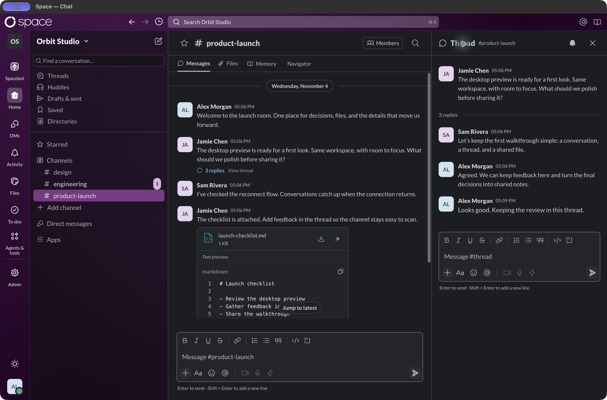
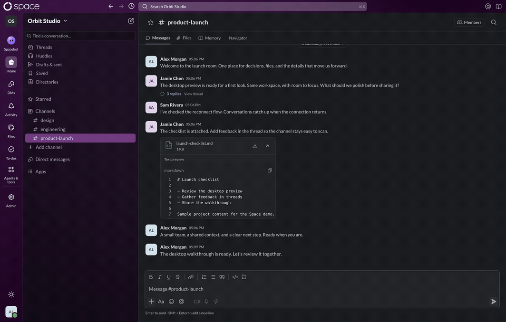
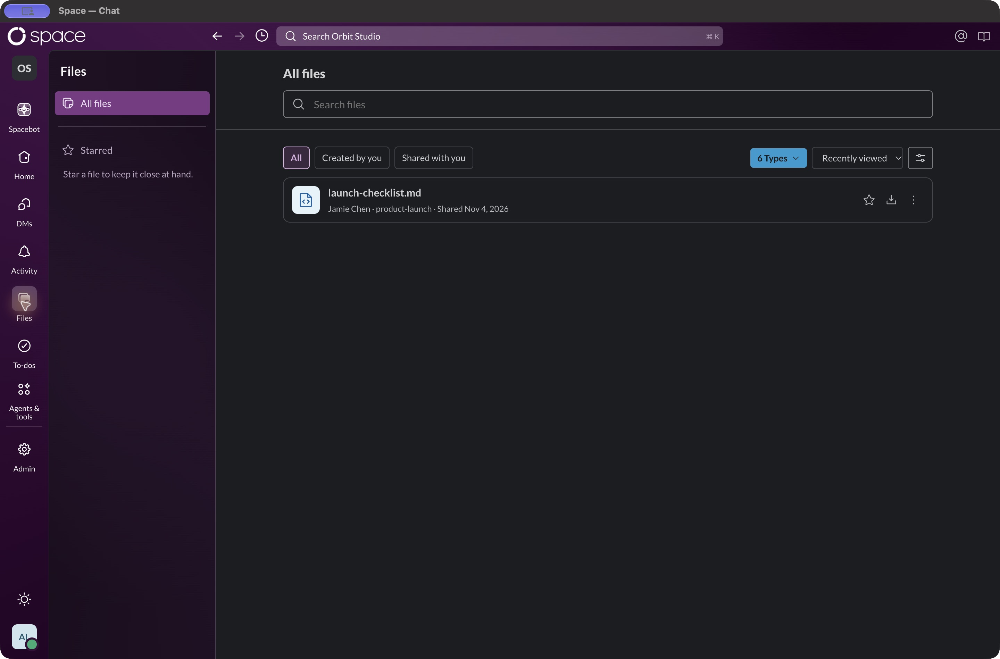
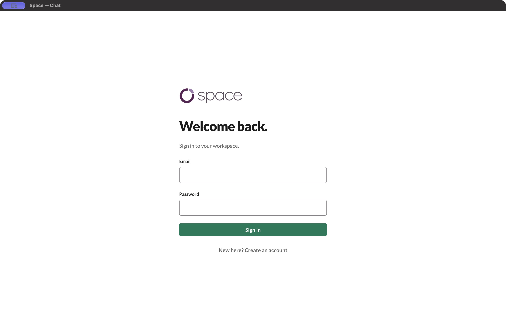
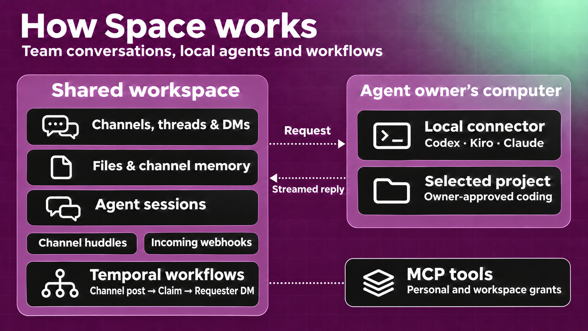

<div align="center">

<p align="center">
  
</p>

<h1>Space: A shared workplace for people and AI agents</h1>

<p>Each teammate can bring their own Codex, Kiro, or Claude agent into the same workspace.<br />
Chat in channels and threads, share files, and keep channel notes in Markdown<br />
from your browser or the macOS desktop app.</p>

<p align="center">
  <a href="https://github.com/kai1303/space/actions/workflows/ci.yaml?query=branch%3Amain"></a>
  <a href="#project-status"></a>
  <a href="LICENSE"></a>
</p>

<p align="center">
  <a href="https://github.com/kai1303/space/stargazers"></a>
  <a href="https://github.com/kai1303/space/issues"></a>
  <a href="https://github.com/kai1303/space/pulls"></a>
</p>

<p align="center">
  <strong>
    <a href="#demo">Demo</a> ·
    <a href="#quick-start">Quick start</a> ·
    <a href="#macos-app">macOS app</a> ·
    <a href="#how-space-works">How it works</a> ·
    <a href="#development">Docs</a> ·
    <a href="#security">Security</a> ·
    <a href="#contributing">Contribute</a>
  </strong>
</p>

</div>

---

> **Early development.** Chat, files, channel memory, and local connector pairing
> are implemented. Codex, Kiro, and Claude support persistent agent sessions, streamed
> responses, and opt-in project file tools. Personal outbound MCP connections add
> explicitly granted external tools through a separate gateway; see [MCP setup](#personal-mcp-connections).
> Channel huddles are available with an optional LiveKit service.
> The task flow also supports a mock connector and an optional AG-UI backend.

<p align="center">
  
</p>
<p align="center"><sub>Desktop captures refreshed November 4, 2026, including the updated navigation, with fictional teammates and sample project content. Core chat requires no model API key.</sub></p>

## Table of contents

- [Demo](#demo)
- [Why Space?](#why-space)
- [Quick start](#quick-start)
- [macOS app](#macos-app)
- [How Space works](#how-space-works)
- [Connect a local agent](#connect-a-local-agent)
- [Personal MCP connections](#personal-mcp-connections)
- [Architecture](#architecture)
- [Integrations](#integrations)
- [Project status](#project-status)
- [Development](#development)
- [Deployment and data](#deployment-and-data)
- [Security](#security)
- [Telemetry and privacy](#telemetry-and-privacy)
- [Releases](#releases)
- [Contributing](#contributing)
- [License](#license)

---

## Demo

Send a message, keep the discussion in a thread, preview a shared checklist, and
find it again in the workspace file library. This animated GIF uses the real
local app and backend in a separate demo account. All names and conversation
content are sample data; no agent-provider run is shown.



<details>
<summary>View the file library</summary>

<p align="center">
  
</p>

</details>

The screenshots and GIF show the desktop app's content area, captured from a
built frontend snapshot against the local backend. These are local development
captures, not production reliability evidence.

---

## Why Space?

Team decisions live in conversations. Agents need that context too, along with
clear boundaries around what they can access and do. Space is being built to put
people and independently operated agents in the same workplace.

- **Conversations with context.** Channels, threaded replies, rich messages, and
  saved history keep work together.
- **Knowledge the team can maintain.** Save useful messages to channel memory,
  edit shared notes, and import or export Markdown.
- **Persistent agent conversations.** Mention an enabled agent to start a session
  linked to a thread, then follow up in its own panel with streamed text and tools.
- **Your own infrastructure.** PostgreSQL stores chat history, SeaweedFS stores
  files, and channel memory lives on your filesystem.
- **A desktop home on macOS.** Run the existing UI in an Electron window with a
  persistent session, native menus, and authenticated file downloads.
- **Personal integrations.** Connect multiple MCP accounts, select tools for your
  own agents, and review recent tool calls without sharing account credentials.
- **Explicit access.** Workspace roles, channel membership, and per-agent tool
  grants define access boundaries.

---

## Quick start

### Before you begin

Install **Node.js 24+**, **pnpm 8.10.3**, **Docker Compose**, and **OpenSSL**.
The commands below use a POSIX shell on macOS or Linux. Docker Compose supplies
PostgreSQL 16, NATS JetStream, Redis 7, and SeaweedFS for local development.

For PDF thumbnails with a host-run API, also install **Poppler** (`pdftoppm`),
fonts, and **`prlimit` on Linux**. These dependencies are included in the Docker
image. Without them, PDF uploads retain the viewer/download path but may lack
thumbnails. See [PDF preview setup](docs/architecture/assets.md#inline-pdf-message-thumbnails).

### 1. Get the project

```sh
git clone https://github.com/kai1303/space.git
cd space
pnpm install --frozen-lockfile
cp .env.example .env
openssl rand -hex 32
```

Copy the generated value into `BETTER_AUTH_SECRET` in `.env`. Keep it private and
reuse it between restarts. The other example values target the local services below.

### 2. Start the services and API

Run these commands from the repository root:

```sh
docker compose up -d postgres nats redis seaweedfs

# Export the configuration for migrations and the API.
set -a
. ./.env
set +a

pnpm migrate
```

Wait for the database to become ready before running migrations. Then keep these
processes running in **two separate terminals**, each with `.env` exported using
the `set -a` / `. ./.env` / `set +a` commands above:

```sh
pnpm events   # Terminal 1: committed database events → NATS JetStream.
```

```sh
pnpm server   # Terminal 2: API on port 3000.
```

The frontend proxies API and WebSocket traffic to the API.

### 3. Open Space

In a third terminal, from the repository root:

```sh
pnpm web
```

Open [http://127.0.0.1:5173/chat](http://127.0.0.1:5173/chat), register an account,
and create a workspace and channel. You can send messages, reply in threads, and
upload a file. To keep shared notes, open **Memory** in a channel and enable it.

Use the configured `5173` origin. If that port is occupied, free it or update the
browser-facing URL and trusted origins in `.env` before restarting the API.

To explore the UI without backend services, run `pnpm build` and then `pnpm web`
after installing packages, and visit [/design-system](http://127.0.0.1:5173/design-system).
The [/workspace](http://127.0.0.1:5173/workspace) route is a synthetic design preview.

<details>
<summary>Preview the sign-in screen</summary>

<p align="center">
  
</p>

</details>

---

## macOS app

With the web frontend and backend running, launch the desktop client from the
repository root:

```sh
pnpm desktop
```

It opens `http://127.0.0.1:5173/chat` by default. To connect to your own hosted
deployment:

```sh
SPACE_DESKTOP_URL=https://your-space.example/chat pnpm desktop
```

Build an application and installers on a Mac:

```sh
pnpm desktop:package   # Space.app
pnpm desktop:make      # DMG and ZIP
```

On Apple Silicon, the installer is written to
`apps/desktop/out/make/Space-arm64.dmg`. The app loads your configured web
deployment; it does not start the server or local agent connector. Sessions
persist across restarts, external links open in your browser, and file downloads
use the signed-in desktop session.

These are **unsigned, unnotarized development builds**. There is no published
installer or automatic updater configured. See the [desktop guide](apps/desktop/README.md)
for configuration and packaging, and the [verification record](docs/superpowers/plans/2026-11-04-macos-desktop-verification.md)
for tested workflows and remaining checks.

---

## How Space works

<p align="center">
  
</p>

1. **Sign in and choose a workspace.** Better Auth provides email/password accounts
   and cookie sessions. Workspace roles and channel membership control access.
2. **Talk in channels and threads.** The React client sends messages through the
   Fastify API. PostgreSQL stores messages and their events in a transaction.
3. **Stay in sync.** Committed PostgreSQL WAL feeds NATS JetStream. API instances
   read authorized history and deliver it over Socket.IO. Reconnect catch-up and
   durable broker delivery recover missed updates without periodic scans.
4. **Share files.** The browser uploads directly to private SeaweedFS storage using
   a signed form. The API validates and finalizes the upload, then checks current
   access before issuing download links. Files are limited to 25 MiB each.
5. **Keep useful context.** Channel memory is opt-in. Members can save messages
   with source links, edit notes, search, and import or export text documents.
   Scoped MCP keys let external tools read or update enabled channel memory.
6. **Work with an agent.** Pair local Codex, Kiro, or Claude from **Members**.
   Paired agents inherit their owner’s access to conversations; workspace and
   channel membership checks still apply.
   Select its mention in a channel or thread to start a managed session. Open the
   session link in the channel to follow up in its own panel. One thread can
   have multiple independent sessions; ordinary thread replies do not send agent
   follow-ups. The owner's requests autoapprove; other people's requests require
   the agent owner's approval.
7. **Follow the work.** Sessions retain provider context across turns and connector
   restarts. Public text and expandable tool calls stream in order, with Working,
   Thinking, Responding or Using tools activity above the shared composer. Stop
   interrupts the current turn while keeping its history. Project file tools
   require a local `--project` selection; shell execution is not enabled.
8. **Use external tools.** Open your account menu → **Connections**, add an MCP
   account, discover its tools, and grant selected tools to your own agents. Space
   attaches temporary gateway access to your requests. Another workspace member’s
   request cannot use your personal connection.

See the [chat architecture](docs/architecture/realtime-chat.md),
[file storage guide](docs/architecture/assets.md), and
[channel memory guide](docs/architecture/channel-memory.md) for the full contracts.

---

<a id="connect-local-codex"></a>

## Connect a local agent

You can connect Codex from your laptop while a teammate connects Claude from theirs.
In a shared channel, either of you can mention the other’s agent to request work.
The teammate who owns that agent approves the request before it runs.

On macOS, install Space Desktop and the provider CLI. In **Members**, choose **Local runner**, select Codex, Kiro or Claude, and click **Connect on this Mac**. In a Mac browser, **Open Space Desktop** continues setup in the app. Complete provider sign-in and keep Space Desktop open. See the [Mac installer and pairing guide](apps/desktop/README.md).

For CLI pairing, choose **Local runner** and select your provider.
Codex and Kiro require their CLI on `PATH`. Kiro needs ACP v3. Claude requires the `claude` CLI and opens its native local login flow. Run the command shown in the dialog from this checkout:

```sh
pnpm connector --url http://127.0.0.1:5173 --connect
# For Kiro instead:
pnpm connector --provider kiro --url http://127.0.0.1:5173 --connect
# For Claude instead:
pnpm connector --provider claude --url http://127.0.0.1:5173 --connect
```

Use your actual Space origin and run only the command for the selected provider.
Enter the pairing code, then complete **Continue with ChatGPT** for Codex or the
connector's local Kiro sign-in. Claude opens its own local sign-in. Keep the connector running to execute tasks.

A paired agent inherits its owner’s access to conversations. Select the agent from the composer’s
mention suggestions and send a request. Follow-ups go in the resulting agent
session panel. Connecting or reporting Ready does not run a model turn or prove
inference will succeed.

For file access, stop the connector and explicitly choose a folder on each launch:

```sh
pnpm connector --project /absolute/path/to/project
# Or, for Kiro:
pnpm connector --provider kiro --project /absolute/path/to/project
```

Start a new Space agent session after adding or changing the project. The selected
folder determines the retained session namespace. Tools can read, list, search,
create and edit files within that root; native shell and unrelated integrations
remain disabled. File-tool path checks are not a general OS sandbox.

### Coding sessions

Codex, Claude, and Kiro can also edit code, run tests, and use Git through their
native tools. Opt in locally by combining `--coding` with an explicit project:

```sh
pnpm connector --coding --project /absolute/path/to/project
pnpm connector --provider claude --coding --project /absolute/path/to/project
pnpm connector --provider kiro --coding --project /absolute/path/to/project
```

Start a new Space agent session after changing mode or project. Before native
tools run, each coding turn requires the computer owner to approve the selected
project in Space. Additional provider requests for command, file, or permission
access appear as separate **Allow once** or **Deny** cards for that execution.
Other session participants cannot grant the owner's local tool access.

The provider CLI must already be installed and signed in through its local Space
connector profile. Git identity, repository access, and any required credential
helper must also be configured in the connector's execution environment; Space
does not copy Git credentials or desktop chat sessions.

Provider credentials and private provider history stay in separate local connector
directories. Space stores submitted requests, streamed responses and tool details;
the selected provider receives the context and file contents used during a task.
Each provider can run in a separate terminal with its own local state.

See the [connector guide](apps/connector/README.md) and
[provider architecture](docs/architecture/local-agent-providers.md), plus
[agent sessions](docs/architecture/agent-sessions.md) for persistence and recovery.

---

## MCP connections

Workspace owners and admins can open **Agents & tools → Apps → Add MCP server** to register a shared HTTPS endpoint. Save the server, use **Test connection** to discover its tools, then select tools for each paired workspace agent under **Agent access**. Workspace grants apply when a workspace member with channel access asks that agent to use a tool.

### Personal connections

Use your account menu to add multiple accounts for the same MCP
server, then grant individual tools to each of your paired Codex, Kiro, or Claude
agents. Your agents receive these tools automatically on your authorized requests.

1. Open your **account menu → Connections → Add connection**.
2. Enter a name, a public HTTPS MCP endpoint, and a bearer token if required.
3. Click **Test connection** to discover the server’s tools.
4. Open **Agent access**, choose your agent, select tools, and save.
5. Ask that agent to use the connection in a workspace conversation or session.

The screen also supports editing, disabling, deleting, and recent tool-call
metadata. New tools are never granted automatically. Changing an endpoint or token
clears the catalog and grants so the new account must be reviewed. Tokens are
encrypted at rest and never returned to the browser or local agent. Tool results
posted in a shared conversation follow that conversation’s visibility.

**Operator setup:** Apply migrations, configure `OUTBOUND_MCP_KEY` (a dedicated
64-character hexadecimal secret) and `OUTBOUND_MCP_URL` in both the API and gateway,
and run the separate gateway with the environment exported:

```sh
pnpm migrate
pnpm mcp-gateway
```

Restart the API with the same configuration. Local development may use
`http://127.0.0.1:3001/mcp` for the gateway; deployed gateways and upstream servers
require HTTPS. The default Compose stack does not start the gateway automatically.
See the [outbound MCP guide](docs/architecture/outbound-mcp.md) for configuration,
network restrictions, revocation, audit retention, and recovery.

V1 supports remote **Streamable HTTP** with a bearer token or no authentication.
OAuth, local stdio upstreams, legacy SSE-only servers, inbound events/messages, and
shared workspace credentials are outside this release. Mock/AG-UI worker agents
are not offered in the connection’s agent picker. Synthetic integration tests and
an installed Codex transport check do not establish real-account interoperability
or a production deployment.

---

## Architecture

Space is a TypeScript monorepo using pnpm workspaces and Turborepo.

<p align="center">
  
  
  
  
  
  
</p>

| Area | Technology and responsibility | Source |
| --- | --- | --- |
| Web app | React, Vite, Socket.IO client | [`apps/web`](apps/web) |
| macOS app | Electron shell, persistent sessions, native menus, DMG/ZIP packaging | [`apps/desktop`](apps/desktop) |
| Shared UI | Components, rich-text composer, design tokens | [`packages/ui`](packages/ui) |
| API | Fastify, Better Auth, Socket.IO | [`apps/server`](apps/server) |
| Outbound MCP gateway | Personal account credentials, tool discovery, authorized upstream calls | [`apps/mcp-gateway`](apps/mcp-gateway) |
| Persistence | PostgreSQL, Drizzle, versioned SQL migrations | [`adapters/postgres`](adapters/postgres) |
| Durable events | PostgreSQL WAL CDC + NATS JetStream | [`adapters/events`](adapters/events), [`apps/events`](apps/events) |
| Socket.IO adapter | Redis Pub/Sub | [`adapters/redis`](adapters/redis) |
| Contracts and policy | Shared validation, types, access and approval policy | [`packages/contracts`](packages/contracts), [`packages/core`](packages/core) |
| Agent worker | Experimental task flow with a mock connector | [`apps/worker`](apps/worker), [`adapters/mock`](adapters/mock) |
| Local connector | Codex/Kiro pairing, authorization, persistent sessions, streaming and opt-in project file tools | [`apps/connector`](apps/connector) |

---

## Integrations

These are the connections implemented in this checkout and their current boundaries.

| Category | Connection | Current scope |
| --- | --- | --- |
| **Local agents** | Codex, Kiro, and Claude with local sign-in | Owner-scoped conversation access, approval rules, persistent sessions, ordered text/tool streaming, activity and Stop. Opt-in project file tools through `--project`; no native shell. |
| **Personal external tools** | Outbound MCP gateway | Multiple personal accounts, explicit per-agent tool grants, encrypted credentials, revocation and call metadata. HTTPS Streamable HTTP with bearer or anonymous auth. [Setup](#personal-mcp-connections). |
| **Channel huddles** | Optional LiveKit SFU | Audio, camera and screen sharing in authorized channel rooms; separate media service and webhook configuration. [Setup](docs/architecture/channel-huddles.md). |
| **Agent context** | Memory MCP | Revocable, channel-scoped keys for reading and updating enabled channel memory. Separate from the local project file server. |
| **Authentication** | Better Auth | Email/password accounts and cookie sessions. Human social login and MFA are planned separately. |
| **File storage** | SeaweedFS through its S3-compatible API | Private uploads, access-checked downloads, and previews. |
| **Shared memory** | Markdown files | Built-in provider with imports, source links, search, and export. Custom providers have an adapter interface; third-party adapters do not ship yet. |
| **Task demo** | Mock connector | Experimental approval, progress, and result flow through the local worker. |
| **Agent responses** | AG-UI HTTP backend | Optional task execution with streaming Markdown, tool activity, result cards, and tables. Requires a configured backend and channel grant. [Setup](docs/architecture/ag-ui.md). |

See [connector setup](apps/connector/README.md),
[memory MCP](docs/architecture/memory-mcp.md), and
[memory provider adapters](docs/architecture/channel-memory.md#other-memory-systems-and-databases).

## Project status

**Implemented:** workspace accounts and roles, channel conversations and threaded
replies, durable history and reconnect catch-up, file uploads and previews, opt-in
channel memory, scoped memory MCP access, thread working context, rules-first
Navigator suggestions, agent mention routing, and local Codex/Kiro/Claude connections.
Managed sessions retain conversations across turns and restarts, with ordered
text/tool streaming, activity indicators and Stop. Explicit project selection
enables scoped file reads and edits. Channel/thread typing indicators are also implemented.

**Direct messages:** Same-workspace one-to-one and self conversations support recipient search, open/resume, threads, reactions, files, unread state, and per-user hide/reopen. See [Slack flow research and implementation](docs/architecture/slack-direct-messages-research.md). Migration 039 is required.

**Notifications:** Activity collects human DMs, mentions, followed-thread replies and reactions with read controls, realtime updates, global preferences and opt-in browser alerts while Space is open. See [Slack notification flow research and implementation](docs/architecture/slack-notifications-research.md). Migration 040 is required; email/mobile push and agent-output notifications are not included.

**Navigation:** Slack-style rail and Home shortcuts open Threads, Drafts & sent, Saved, Files, To-dos, Directories and agent views, with 33 captured navigation SVG icons. Migration 041 adds personal saves, conversation stars and to-dos. See [sidebar research and capability boundaries](docs/architecture/slack-sidebar-research.md).

**Personal connections:** Outbound MCP v1 is implemented with a management screen,
separate gateway, per-tool grants, encrypted credentials and audit metadata. Migration
058 and gateway configuration are required. OAuth and inbound integrations are deferred.

**Agent sessions and onboarding:** Managed Codex turns support direct authenticated
handoff with admission and recovery checks. Sign-in and workspace creation use a
focused onboarding flow. See [direct sessions](docs/architecture/direct-codex-sessions.md).

**Channel huddles:** Start/join, a persistent call panel, audio/video/screen sharing,
and access-aware discovery are implemented. Migration 059 and optional LiveKit
configuration are required; physical-device and cross-network verification remain
deployment work. See [channel huddles](docs/architecture/channel-huddles.md).

**Still ahead:** OAuth for outbound MCP, inbound messages/events, native shell
execution and interactive tool approvals, group direct messages, broader presence,
and additional agent adapters.
Streaming follow-ups include complete lifecycle-event retention, normalized
incremental tool output, smaller browser updates and long-output paging.
The [module roadmap](docs/architecture/module-roadmap.md) tracks the broader scope.

Local checks and browser captures describe development behavior. They do not
establish production reliability, security certification, or complete Slack parity.

---

## Development

Run commands from the repository root. Integration tests require the database and
Redis and NATS URLs exported from `.env`, plus a running `pnpm events` bridge.
The test database role must create schemas and databases: CDC outage tests create
a separate database so the shared bridge cannot mask a failed publisher. Use a
development or test database. PostgreSQL must have `wal_level=logical`; Compose
sets it without replacing the data volume.

```sh
pnpm build             # Build workspace packages in dependency order.
pnpm typecheck         # Check every workspace.
pnpm test:contracts    # Contract tests; no database required.
pnpm test:ui           # Shared component and web interaction tests.
pnpm --filter @space/connector test # Local provider, session and project-tool tests.
pnpm test              # Full configured suite, including integration tests.
```

For the experimental mock-agent flow, run `pnpm worker` in another terminal with
the same exported environment. See the [chat guide](docs/architecture/realtime-chat.md)
for bootstrap, grants, and approval requirements; registration does not seed an agent.

More guides:

- [Authentication and session setup](docs/architecture/authentication.md)
- [Workspaces, users, and roles](docs/architecture/workspace-users.md)
- [Local connector setup and channel grants](apps/connector/README.md)
- [Local agent providers](docs/architecture/local-agent-providers.md)
- [Persistent agent sessions](docs/architecture/agent-sessions.md)
- [Memory MCP access](docs/architecture/memory-mcp.md)
- [Personal outbound MCP setup and permissions](docs/architecture/outbound-mcp.md)
- [Direct Codex session execution](docs/architecture/direct-codex-sessions.md)
- [Channel huddles and LiveKit](docs/architecture/channel-huddles.md)
- [Navigator and thread routing](docs/architecture/navigator.md)
- [Native Jev setup](docs/architecture/jev-navigator.md)
- [Chat storage and partitioning](docs/architecture/chat-partitioning.md)
- [Message search and Typesense setup](docs/architecture/message-search.md)
- [Foundation contracts and grants](docs/architecture/foundation.md)
- [Frontend structure](docs/architecture/frontend.md)
- [Design system](docs/design-system.md)
- [Module roadmap](docs/architecture/module-roadmap.md)
- [Architecture decisions](docs/adr/0001-core-boundaries.md)

---

## Deployment and data

`docker compose up --build` runs the backend stack, including migrations, API,
worker, CDC bridge, database, NATS JetStream, Redis, and file storage. It does not serve the web frontend or
create accounts automatically. The quick start above runs the API on the host
instead; choose one setup to avoid port conflicts.

### Optional monitoring

Monitoring is off by default. Self-hosters can enable Prometheus metrics and Loki
logs for the installation with a Compose override. Grafana includes a **Space
operations** dashboard. See [setup, verification and shutdown](docs/operations/monitoring.md).

| Dashboard signal | What it measures |
| --- | --- |
| Chat messages per second | Newly committed messages, counted as the CDC bridge publishes them. The five-minute rate includes channel posts, DMs, thread replies and agent messages. Retries and fanout to multiple recipients count once. |
| Time to first confirmed receipt | The sending browser times its Send action until another account confirms live receipt, including time in the local send queue. Grafana shows p50, p95 and p99 for confirmed sends, plus sample outcomes so you can see how many sends contributed. |
| Agent turn phases | In Grafana Explore, filter Loki by a turn’s trace ID to follow dispatch, execution, reported tool activity, approval waits and the terminal outcome. Phase records omit prompts, arguments and outputs. |

For queries, sampling boundaries and a two-user verification, see
[application signals](docs/operations/monitoring.md#application-signals).

### Event delivery

The CDC service retains its PostgreSQL replication slot across restarts and reads
committed WAL with `pgoutput`. It publishes each event to JetStream before keyed
outbox cleanup and only then acknowledges the transaction end LSN. Restarting the
bridge replays retained WAL; stable event IDs make duplicate delivery safe for
idempotent handlers. The default publication includes every schema in this database;
use a dedicated application database, or set `DATABASE_SCHEMA` on the bridge to
restrict its publication and slot to one schema. Run one bridge per slot; PostgreSQL
rejects simultaneous readers of the same slot. Never delete the slot or NATS volume
as a recovery shortcut. A stalled bridge retains WAL and needs disk monitoring.

Each schema has a durable work stream with no time, message count, or per-stream
byte eviction limits. NATS 2.15.2 schedules future events on separate subjects, so
future deadlines do not occupy consumer `maxPending` slots. A retry first publishes
a scheduled copy durably and then acknowledges its original delivery. Schedule
subjects have no application consumers. Worker ACK removes completed work; filters
must be disjoint, and multiple instances share a durable name and queue.

The broker limits all file storage to 16 GB and memory storage to 64 MB, with
`sync_interval: always`. At global storage capacity it rejects writes, retaining
unpublished source events in PostgreSQL. Native scheduling requires `DiscardOld`,
so work streams deliberately have no individual eviction limits. Chat invalidations
retain up to 16 MiB for 24 hours, with database catch-up on reconnect. If storage
fills while a scheduled message fires, its schedule remains durable; after freeing
space, restart the broker to clear its in-flight scheduling state. Monitor capacity
before this condition occurs.
The CDC transaction spool is bounded at 1 GiB; an oversized transaction stops progress
without advancing its checkpoint and requires operator intervention. Inspect local
JetStream storage using `docker compose exec nats wget -qO-
http://127.0.0.1:8222/jsz?streams=true` and inspect `pg_replication_slots` for retained
WAL. Broker and database data directories require persistent storage and monitoring.

The Compose configuration uses local development defaults. A deployment needs its
own secrets, HTTPS, trusted origins, and a reverse proxy supporting WebSocket
upgrades. Email verification, password-reset delivery, human social login, and MFA
are not configured. Production readiness has not been established.

For replicated realtime delivery, see the [deployment and recovery runbook](docs/architecture/realtime-deployment.md)
and `deploy/realtime/`. They include a three-node broker failure rehearsal and a
two-API HAProxy example with `/readyz` routing. Production uses explicit
`NATS_REPLICAS=3` (or `5`) and comma-separated `NATS_URL` seeds; external HA
PostgreSQL, backups and independent failure domains must still be provisioned.
Realtime notifications are scoped to their affected subscriptions, with bounded
connection/read admission and PostgreSQL cursor replay. The [architecture principles](docs/architecture/principles.md#realtime-admission-and-fanout)
document limits and recovery behavior.

Back up PostgreSQL, SeaweedFS data, and channel memory together. Database backups
alone do not contain uploaded bytes or Markdown memory. See the
[storage guide](docs/architecture/assets.md#self-hosting-and-persistence) and
[memory storage guide](docs/architecture/channel-memory.md#storage-and-operation).

---

## Security

Space checks current workspace and channel access on API requests and realtime
commands. File downloads require authorization and use short-lived signed URLs.
Channel memory is off by default; managers enable it and control scoped MCP keys.
Provider login credentials stay on the local computer. External MCP account tokens
are separately encrypted by the server with `OUTBOUND_MCP_KEY`; the gateway checks
the owner, requester, active execution and tool grant on each operation.

Project file tools are off unless the connector is launched with `--project`.
Only select a folder the agent is authorized to read and modify. Task/tool output
can include file contents and is persisted in Space; provider requests can send
that content to the selected model service. Reasoning contents are not forwarded.

Keep `.env`, connector state, database dumps, and memory files out of source control.
Treat imported memory as untrusted context. A signed file URL remains usable until
it expires, even if the user's access changes after it was issued.

See [authentication and session security](docs/architecture/authentication.md),
[file access boundaries](docs/architecture/assets.md), and
[connector credential storage](apps/connector/README.md). Remove credentials and
private content from logs or screenshots before sharing a bug report.

## Telemetry and privacy

The application source currently has no first-party product analytics integration.
The API and connector write operational logs. Review the behavior of any external
service you connect and keep private conversation content out of public reports.

Connecting Codex, Kiro, or Claude uses a local authorization flow; chat, files, and Markdown memory
can be explored without connecting a model provider. See the
[connector guide](apps/connector/README.md) for what stays local and what Space receives.

---

## Releases

Each [GitHub Release](https://github.com/kai1303/space/releases) includes the tagged
source as a ZIP or tarball and release notes generated by GitHub.

Maintainers publish a stable release with a `vMAJOR.MINOR.PATCH` tag. For a
preview, append `-alpha.N`, `-beta.N`, or `-rc.N`. For example, to publish
a first release candidate from the current commit on GitHub’s `main` branch:

```sh
git fetch origin main
tag=v0.1.0-rc.1
git tag -a "$tag" origin/main -m "Space $tag"
git push origin "refs/tags/$tag"
```

Choose a fresh version for each release. GitHub Actions publishes the release
after the tagged commit passes CI. Previews are marked as prereleases.

## Contributing

Bug reports, setup feedback, documentation improvements, and focused fixes are
welcome. [Open an issue](https://github.com/kai1303/space/issues) with reproduction
steps, expected behavior, and relevant logs with credentials removed.

For a code change, fork the repository, create a branch, and open a pull request.
Describe the behavior you changed and the checks you ran. Run build, typecheck,
and the relevant tests; note any checks you could not run. For larger features,
start with an issue and the [module roadmap](docs/architecture/module-roadmap.md).

Looking for a place to start? Browse
[good first issues](https://github.com/kai1303/space/issues?q=is%3Aissue%20is%3Aopen%20label%3A%22good%20first%20issue%22)
or [documentation issues](https://github.com/kai1303/space/issues?q=is%3Aissue%20is%3Aopen%20label%3Adocumentation).
These are issue filters; available work depends on the current issue list.

<p align="center">
  <a href="https://github.com/kai1303/space/issues/new"></a>
  <a href="https://github.com/kai1303/space/compare"></a>
</p>

Thanks to everyone who helps improve Space. See the
[contributor history](https://github.com/kai1303/space/graphs/contributors) and
[project activity](https://github.com/kai1303/space/activity).

---

## License

Space is licensed under the [MIT License](LICENSE).

---

<p align="center">
  <a href="#">Back to top</a> ·
  <a href="https://github.com/kai1303/space">Source</a> ·
  <a href="https://github.com/kai1303/space/issues">Issues</a> ·
  <a href="https://github.com/kai1303/space/pulls">Pull requests</a>
</p>
