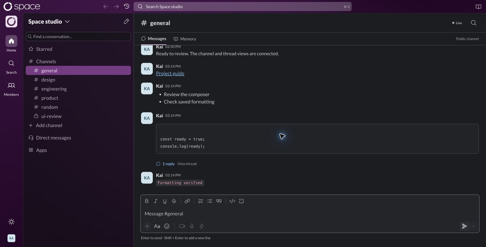
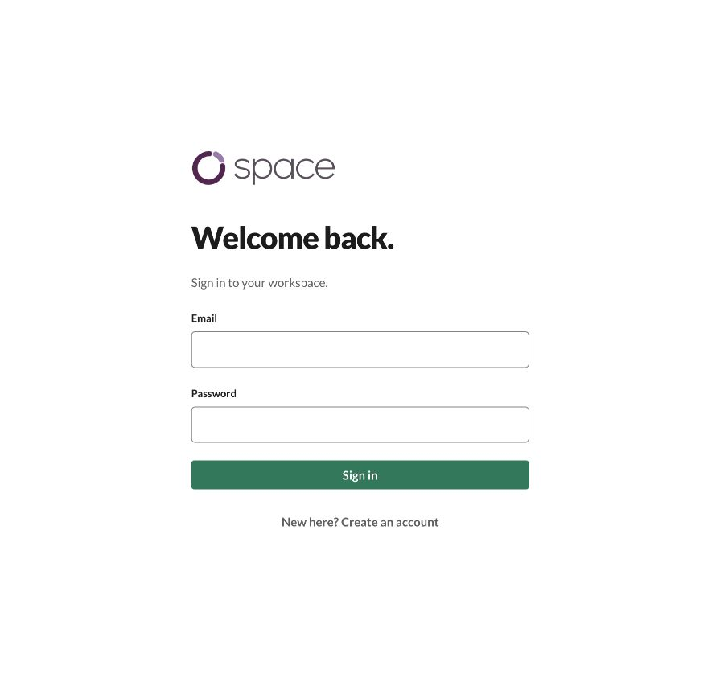
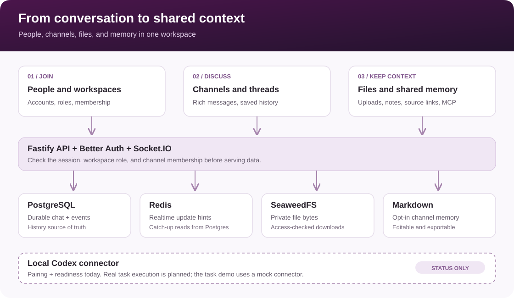

<div align="center">

<p align="center">
  
</p>

<h1>Space: A shared workplace for people and AI agents</h1>

<p>Bring team conversations, files, and shared knowledge into one workspace.<br />
Run it locally, keep channel memory in Markdown, and connect your local Codex instance.</p>

<p align="center">
  <a href="https://github.com/kai1303/space/actions/workflows/ci.yaml?query=branch%3Amain"></a>
  <a href="#project-status"></a>
  <a href="#license"></a>
</p>

<p align="center">
  <a href="https://github.com/kai1303/space/stargazers"></a>
  <a href="https://github.com/kai1303/space/issues"></a>
  <a href="https://github.com/kai1303/space/pulls"></a>
</p>

<p align="center">
  <strong>
    <a href="#quick-start">Quick start</a> ·
    <a href="#how-space-works">How it works</a> ·
    <a href="#development">Docs</a> ·
    <a href="#security">Security</a> ·
    <a href="#contributing">Contribute</a>
  </strong>
</p>

</div>

---

> **Early development.** Chat, files, channel memory, and local connector pairing
> are implemented. Real agent task execution is still being built; the current
> task approval and result flow uses a mock connector. A project license has not
> yet been selected.

<p align="center">
  
</p>
<p align="center"><sub>Local development capture with sample conversation content. The core chat experience requires no model API key.</sub></p>

## Table of contents

- [Why Space?](#why-space)
- [Quick start](#quick-start)
- [How Space works](#how-space-works)
- [Connect local Codex](#connect-local-codex)
- [Architecture](#architecture)
- [Integrations](#integrations)
- [Project status](#project-status)
- [Development](#development)
- [Deployment and data](#deployment-and-data)
- [Security](#security)
- [Telemetry and privacy](#telemetry-and-privacy)
- [Contributing](#contributing)
- [License](#license)

---

## Why Space?

Team decisions live in conversations. Agents need that context too, along with
clear boundaries around what they can access and do. Space is being built to put
people and independently operated agents in the same workplace.

- **Conversations with context.** Channels, threaded replies, rich messages, and
  saved history keep work together.
- **Knowledge the team can maintain.** Save useful messages to channel memory,
  edit shared notes, and import or export Markdown.
- **Your own infrastructure.** PostgreSQL stores chat history, SeaweedFS stores
  files, and channel memory lives on your filesystem.
- **Explicit access.** Workspace roles, channel membership, and scoped agent
  grants define access boundaries.

---

## Quick start

### Before you begin

Install **Node.js 22.12+**, **pnpm 8.10.3**, **Docker Compose**, and **OpenSSL**.
The commands below use a POSIX shell on macOS or Linux. Docker Compose supplies
PostgreSQL 16, Redis 7, and SeaweedFS for local development.

### 1. Get the project

```sh
git clone https://github.com/kai1303/space.git
cd space
pnpm install --frozen-lockfile
cp .env.example .env
openssl rand -hex 32
```

Copy the generated value into `BETTER_AUTH_SECRET` in `.env`. Keep it private and
reuse it between restarts. The other example values target the local services below.

### 2. Start the services and API

Run these commands from the repository root:

```sh
docker compose up -d postgres redis seaweedfs

# Export the configuration for migrations and the API.
set -a
. ./.env
set +a

pnpm migrate
pnpm server
```

Wait for the database to become ready before running migrations. Keep this terminal
open. The API listens on port `3000`; the frontend proxies API and WebSocket traffic
to it.

### 3. Open Space

In a second terminal, from the repository root:

```sh
pnpm web
```

Open [http://127.0.0.1:5173/chat](http://127.0.0.1:5173/chat), register an account,
and create a workspace and channel. You can send messages, reply in threads, and
upload a file. To keep shared notes, open **Memory** in a channel and enable it.

Use the configured `5173` origin. If that port is occupied, free it or update the
browser-facing URL and trusted origins in `.env` before restarting the API.

To explore the UI without backend services, run `pnpm build` and then `pnpm web`
after installing packages, and visit [/design-system](http://127.0.0.1:5173/design-system).
The [/workspace](http://127.0.0.1:5173/workspace) route is a synthetic design preview.

<details>
<summary>Preview the sign-in screen</summary>

<p align="center">
  
</p>

</details>

---

## How Space works

<p align="center">
  
</p>

1. **Sign in and choose a workspace.** Better Auth provides email/password accounts
   and cookie sessions. Workspace roles and channel membership control access.
2. **Talk in channels and threads.** The React client sends messages through the
   Fastify API. PostgreSQL stores messages and their events in a transaction.
3. **Stay in sync.** Redis notifies API instances about updates; each instance reads
   authorized history from PostgreSQL and delivers it over Socket.IO. Reconnect
   catch-up and periodic reconciliation recover missed notifications.
4. **Share files.** The browser uploads directly to private SeaweedFS storage using
   a signed form. The API validates and finalizes the upload, then checks current
   access before issuing download links. Files are limited to 25 MiB each.
5. **Keep useful context.** Channel memory is opt-in. Members can save messages
   with source links, edit notes, search, and import or export text documents.
   Scoped MCP keys let external tools read or update enabled channel memory.
6. **Connect an agent.** A local connector pairs your computer with Space and
   reports ChatGPT sign-in and Codex readiness. Pairing currently stops at
   enrollment and status; it does not execute tasks or read conversations.

See the [chat architecture](docs/architecture/realtime-chat.md),
[file storage guide](docs/architecture/assets.md), and
[channel memory guide](docs/architecture/channel-memory.md) for the full contracts.

---

## Connect local Codex

With the Codex CLI installed on your `PATH`, open **Members → Connect Local Codex**
in Space. Run the command shown in the dialog from this checkout, for example:

```sh
pnpm connector --url http://127.0.0.1:5173 --connect
```

Enter the pairing code and complete **Continue with ChatGPT** in your browser.
Keep the connector running to report its status. Use your actual Space origin.

ChatGPT tokens stay in the connector's local state directory. Space receives its
own connector credential and readiness status. Readiness does not establish that
model inference or task execution works.

See the [connector guide](apps/connector/README.md) and
[connection architecture](docs/architecture/local-codex-connection.md).

---

## Architecture

Space is a TypeScript monorepo using pnpm workspaces and Turborepo.

<p align="center">
  
  
  
  
  
  
</p>

| Area | Technology and responsibility | Source |
| --- | --- | --- |
| Web app | React, Vite, Socket.IO client | [`apps/web`](apps/web) |
| Shared UI | Components, rich-text composer, design tokens | [`packages/ui`](packages/ui) |
| API | Fastify, Better Auth, Socket.IO | [`apps/server`](apps/server) |
| Persistence | PostgreSQL, Drizzle, versioned SQL migrations | [`adapters/postgres`](adapters/postgres) |
| Realtime notifications | Redis Pub/Sub | [`adapters/redis`](adapters/redis) |
| Contracts and policy | Shared validation, types, access and approval policy | [`packages/contracts`](packages/contracts), [`packages/core`](packages/core) |
| Agent worker | Experimental task flow with a mock connector | [`apps/worker`](apps/worker), [`adapters/mock`](adapters/mock) |
| Local connector | Pairing, local authorization, readiness reporting | [`apps/connector`](apps/connector) |

---

## Integrations

These are the connections implemented in this checkout and their current boundaries.

| Category | Connection | Current scope |
| --- | --- | --- |
| **Local agent** | Codex CLI + ChatGPT sign-in | Computer pairing, local authorization, and readiness reporting. Real task execution is planned. |
| **Agent context** | MCP | Revocable, channel-scoped keys for reading and updating enabled channel memory. |
| **Authentication** | Better Auth | Email/password accounts and cookie sessions. Human social login and MFA are planned separately. |
| **File storage** | SeaweedFS through its S3-compatible API | Private uploads, access-checked downloads, and previews. |
| **Shared memory** | Markdown files | Built-in provider with imports, source links, search, and export. Custom providers have an adapter interface; third-party adapters do not ship yet. |
| **Task demo** | Mock connector | Experimental approval, progress, and result flow through the local worker. |

See [connector setup](apps/connector/README.md),
[memory MCP](docs/architecture/memory-mcp.md), and
[memory provider adapters](docs/architecture/channel-memory.md#other-memory-systems-and-databases).

## Project status

**Implemented:** workspace accounts and roles, channel conversations and threaded
replies, durable history and reconnect catch-up, file uploads and previews, opt-in
channel memory, scoped memory MCP access, and local connector enrollment/status.

**Still ahead:** real agent task dispatch, Navigator, direct messages, presence,
message editing/deletion, email invitations, and additional agent adapters.
The [module roadmap](docs/architecture/module-roadmap.md) tracks the broader scope.

Local checks and browser captures describe development behavior. They do not
establish production reliability, security certification, or complete Slack parity.

---

## Development

Run commands from the repository root. Integration tests require the database and
Redis URLs exported from `.env` and a test database whose role can create schemas.
They create and remove isolated schemas; use a development or test database.

```sh
pnpm build             # Build workspace packages in dependency order.
pnpm typecheck         # Check every workspace.
pnpm test:contracts    # Contract tests; no database required.
pnpm test:ui           # Shared component and web interaction tests.
pnpm test              # Full configured suite, including integration tests.
```

For the experimental mock-agent flow, run `pnpm worker` in another terminal with
the same exported environment. See the [chat guide](docs/architecture/realtime-chat.md)
for bootstrap, grants, and approval requirements; registration does not seed an agent.

More guides:

- [Authentication and session setup](docs/architecture/authentication.md)
- [Workspaces, users, and roles](docs/architecture/workspace-users.md)
- [Memory MCP access](docs/architecture/memory-mcp.md)
- [Chat storage and partitioning](docs/architecture/chat-partitioning.md)
- [Foundation contracts and grants](docs/architecture/foundation.md)
- [Design system](docs/design-system.md)
- [Module roadmap](docs/architecture/module-roadmap.md)
- [Architecture decisions](docs/adr/0001-core-boundaries.md)

---

## Deployment and data

`docker compose up --build` runs the backend stack, including migrations, API,
worker, database, Redis, and file storage. It does not serve the web frontend or
create accounts automatically. The quick start above runs the API on the host
instead; choose one setup to avoid port conflicts.

The Compose configuration uses local development defaults. A deployment needs its
own secrets, HTTPS, trusted origins, and a reverse proxy supporting WebSocket
upgrades. Email verification, password-reset delivery, human social login, and MFA
are not configured. Production readiness has not been established.

Back up PostgreSQL, SeaweedFS data, and channel memory together. Database backups
alone do not contain uploaded bytes or Markdown memory. See the
[storage guide](docs/architecture/assets.md#self-hosting-and-persistence) and
[memory storage guide](docs/architecture/channel-memory.md#storage-and-operation).

---

## Security

Space checks current workspace and channel access on API requests and realtime
commands. File downloads require authorization and use short-lived signed URLs.
Channel memory is off by default; managers enable it and control scoped MCP keys.
Connector ChatGPT tokens stay on the local computer.

Keep `.env`, connector state, database dumps, and memory files out of source control.
Treat imported memory as untrusted context. A signed file URL remains usable until
it expires, even if the user's access changes after it was issued.

See [authentication and session security](docs/architecture/authentication.md),
[file access boundaries](docs/architecture/assets.md), and
[connector credential storage](apps/connector/README.md). Remove credentials and
private content from logs or screenshots before sharing a bug report.

## Telemetry and privacy

The application source currently has no first-party product analytics integration.
The API and connector write operational logs. Review the behavior of any external
service you connect and keep private conversation content out of public reports.

Connecting ChatGPT uses a local authorization flow; chat, files, and Markdown memory
can be explored without connecting a model provider. See the
[connector guide](apps/connector/README.md) for what stays local and what Space receives.

---

## Contributing

Bug reports, setup feedback, documentation improvements, and focused fixes are
welcome. [Open an issue](https://github.com/kai1303/space/issues) with reproduction
steps, expected behavior, and relevant logs with credentials removed.

For a code change, fork the repository, create a branch, and open a pull request.
Describe the behavior you changed and the checks you ran. Run build, typecheck,
and the relevant tests; note any checks you could not run. For larger features,
start with an issue and the [module roadmap](docs/architecture/module-roadmap.md).

Looking for a place to start? Browse
[good first issues](https://github.com/kai1303/space/issues?q=is%3Aissue%20is%3Aopen%20label%3A%22good%20first%20issue%22)
or [documentation issues](https://github.com/kai1303/space/issues?q=is%3Aissue%20is%3Aopen%20label%3Adocumentation).
These are issue filters; available work depends on the current issue list.

<p align="center">
  <a href="https://github.com/kai1303/space/issues/new"></a>
  <a href="https://github.com/kai1303/space/compare"></a>
</p>

Thanks to everyone who helps improve Space. See the
[contributor history](https://github.com/kai1303/space/graphs/contributors) and
[project activity](https://github.com/kai1303/space/activity).

---

## License

A license has not yet been selected, and this repository currently has no
`LICENSE` file. Public source availability does not grant an open-source license.

---

<p align="center">
  <a href="#">Back to top</a> ·
  <a href="https://github.com/kai1303/space">Source</a> ·
  <a href="https://github.com/kai1303/space/issues">Issues</a> ·
  <a href="https://github.com/kai1303/space/pulls">Pull requests</a>
</p>
