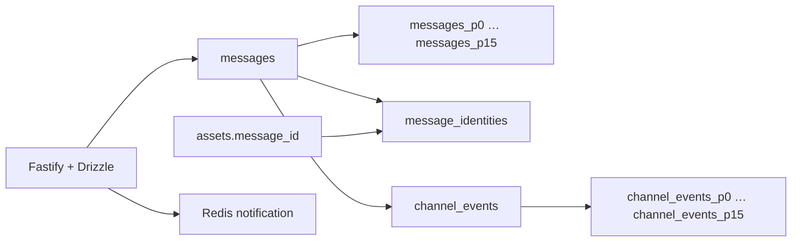

# Chat storage partitions

Migration 018 partitions `messages` and `channel_events` by `HASH(channel_id)`, with
16 physical partitions for each table. PostgreSQL routes inserts automatically;
clients continue addressing the parent tables through the same HTTP and Socket.IO
contracts. This is partitioning inside one PostgreSQL database, not distribution
across database servers.



Channel and thread queries include the channel ID, allowing PostgreSQL to exclude
the other 15 partitions. Message sequence indexes still support forward and backward
cursor pagination. The replay log uses the same channel key; immutable message and
event sequence values are unchanged. Legacy thread queries resolve the channel before
reading history. Retry lookup uses the identity registry to locate the message's channel.

## Identity and integrity

Partitioned unique constraints must include the partition key. A narrow
`message_identities` table therefore retains global message UUID uniqueness,
global task-result uniqueness, and `(workspace_id, user_id, client_message_id)`
retry uniqueness. It stores routing and retry metadata, not message bodies.

Message and registry rows must both exist at transaction commit, enforced with
reciprocal deferred foreign keys. Message insert/delete triggers maintain the registry.
Identity updates and deletion while a message still exists are rejected. The assets
foreign key references the registry, which in turn references the actual message;
an attached message cannot be deleted while its asset reference remains.

Local unique indexes allow same-channel duplicate inserts using `ON CONFLICT DO NOTHING`
to skip the row without leaving registry entries. Cross-channel global identity collisions
raise a unique violation. Application retries retain their existing successful replay or
`idempotency_conflict` behavior. Human and trusted agent messages use the same storage path.

## Migration and operation

Build the application before running the normal migration command with the deployment's
database environment configured:

```sh
pnpm build
pnpm migrate
```

For an existing database, first back it up and pause API, worker, and direct SQL writers.
Migration 018 locks the affected tables, copies rows with message/event triggers disabled
on the new tables, compares counts and every copied field, then switches the parent tables,
foreign keys, functions and triggers in the migrator's transaction. Sequence counters and
replay payloads are not rewritten. A failed migration rolls back the entire switch. Lock
acquisition times out after five seconds so a busy database fails cleanly.

This is a maintenance migration, not an online migration. A large database needs a
maintenance window and disk headroom for old and new tables plus indexes during the copy.
Planner statistics are refreshed for the new tables. Restart API and worker processes
after the migration, and verify history reads and realtime delivery.

Hash partitions do not expire automatically or require a monthly creation job. History
remains retained indefinitely. All messages for one channel stay together, so one very hot
channel can still dominate its partition and channel counter. Increasing the partition
count requires planned data redistribution. The global identity indexes also continue to
grow with message count.

Tests verify partition metadata, query pruning, duplicate prevention, attachment integrity,
exact migration preservation, and rollback after a failure injected at migration-version
recording. `EXPLAIN` evidence establishes that scoped queries read one physical partition;
it does not establish a production throughput improvement.

PostgreSQL's [partitioning documentation](https://www.postgresql.org/docs/16/ddl-partitioning.html)
describes partition pruning, unique-key restrictions, and hash partition tradeoffs.
