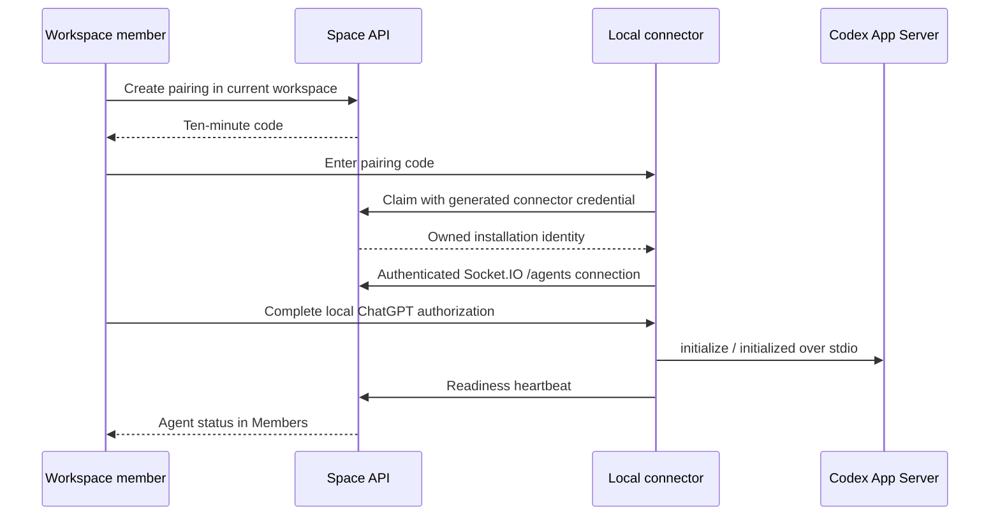

# Local Codex connection

Local Codex enrollment shows an owned agent alongside human workspace members.
After the owner explicitly enables it for a channel, the connector can claim
approved `codex.run` tasks and return streamed responses. Pairing grants no channel
access. Repository selection is absent from this chat integration.

## Setup

Apply migrations with `pnpm migrate`, build with `pnpm build`, and run the existing
API, Redis and web app. Open **Members → Connect Local Codex** in chat. Run the
displayed `pnpm connector --url <web-origin> --connect` command from this checkout;
the local machine needs Node 22+ and the Codex CLI on PATH. Enter the code at the
terminal prompt, then open the connector's Continue with ChatGPT URL yourself.
Keep the connector running. Subsequent `pnpm connector` starts reuse the saved pairing.

The connector's [guide](../../apps/connector/README.md) documents local credential
storage, login/logout, lock recovery and the OSS versus hosted-service boundary.
Personal ChatGPT authorization remains local; Space never receives OpenAI tokens.

## Connection sequence

## Ownership and state

- Pairing requires current workspace membership. A new code cancels
  the same owner's previous unclaimed code in that workspace. The owner can cancel it.
- Claiming is transactional. Space stores SHA-256 hashes of codes and connector
  credentials. Retrying the same code and credential returns the same installation;
  a different credential cannot replay a claimed code.
- An installation has a human owner and a Local Codex definition, with the `codex.run`
  capability and no channel grants. It is not a synthetic human login.
- The separate `/agents` namespace accepts connector credentials only. Human chat
  sockets and HTTP user sessions do not accept them. Heartbeats recheck membership,
  revocation and the current connection generation; stale sockets cannot overwrite
  a replacement connection's status.
- Heartbeats occur every ten seconds; the directory treats a connection older than
  45 seconds as offline. Local auth reports required, ready or error. Ready requires
  OAuth validation and Codex initialization, not proof of successful inference.
- Owner revocation disables the installation and clears its credential. Active
  sockets are rejected on heartbeat or periodic revalidation within ten seconds.
  Workspace offboarding also prevents further authenticated use.
- Transient transport loss and graceful server restart reconnect with bounded
  backoff. A rejected credential requires a fresh pairing.

## Interfaces

| Interface | Purpose |
| --- | --- |
| `POST /v1/workspaces/:id/agent-pairings` | Create code, optional display name |
| `GET /v1/agent-pairings/:id` | Owner reads pending/claimed/expired/cancelled state |
| `POST /v1/agent-pairings/:id/cancel` | Owner cancels unclaimed code |
| `POST /v1/agent-pairings/claim` | Public, rate-limited code exchange |
| `GET /v1/workspaces/:id/participants` | Paginated human and agent directory |
| `POST /v1/agents/connections/:id/revoke` | Owner disconnects installation |
| `/agents`, `agent.heartbeat` | Authenticated readiness updates |
| `GET /v1/channels/:id/local-codex` | Owner's paired agents and channel enablement |
| `POST /v1/agents/connections/:id/channels/:channelId` | Owner enables or disables the channel grant |
| `/agents`, `agent.task.claim/event/renew/finish/fail` | Scoped task delivery and persisted event acknowledgements |

Local task claims exclude every other installation, and ordinary workers exclude
`codex.local`. Each installation has a durable broker consumer; a ready socket accepts only its offered delivery ID. A conditional write creates one attempt with a renewable 30-second execution deadline during a maximum two-minute model turn. Attempt tokens fence results; expired deadlines never authorize another owner. Event acceptance rechecks installation, task,
channel access, grant, socket generation, and live lease. Disconnects and expired
leases fail visibly; uncertain claims are never automatically invoked again.
Legacy tasks use ephemeral tool-free turns. Managed [agent sessions](agent-sessions.md) retain a private, scoped Codex home and resume the same conversation across turns and connector restarts. Both modes deny unsupported tool or approval requests.

PostgreSQL persists enrollment, status, tasks, events, and responses. Socket.IO carries heartbeats directly;
Committed PostgreSQL WAL feeds durable NATS JetStream work events and deadline messages. Socket.IO delivers the broker offer to the connector, then carries execution commands/results.

## Verification boundaries

Integration tests cover tenancy, replay/concurrent claims, expiry/cancellation,
hashed storage, no implicit grants, current membership, stale socket fencing and
revocation. Connector tests use synthetic OAuth responses, signing keys, loopback
callbacks, child processes and real Socket.IO connections. UI tests cover socket updates,
claim/expiry, cancellation, errors and workspace/unmount isolation.

Real ChatGPT authorization, installed Codex 0.146.0 initialization and a completed
model turn were verified on 2026-11-03. The runtime returned the exact smoke-test
response using `gpt-5.6-sol`, with no tool use. Restarting the production connector
reused and refreshed saved authorization, and Space returned to Online.
See [real Codex E2E evidence](../real-codex-e2e-qa.md). That historical prompt test used the
connector's runtime directly. The chat dispatch path is covered separately by
`tests/integration/local-codex.test.ts` and connector task tests; real browser
verification must be recorded separately from these synthetic checks.

## Capability-based integrations

The generic channel integration API is `GET /v1/channels/:channelId/agents`; legacy local-provider listings remain compatibility aliases. Owned installations advertise supported and granted skills plus `persistent_sessions`. Grant each skill explicitly. The historical omitted-skill request is accepted only when an installation supports one skill. Session creation accepts `skill`, requires a matching channel grant and persistent-session capability, and defaults only when one granted skill is unambiguous.

Operators may supply a trusted `pairedConnectors` registry to `createApi`. Each descriptor has `id`, `definition_id`, `name`, `capabilities` (skills, controls, optional `persistent_sessions`) and an optional built-in local `provider`. Existing Codex and Kiro descriptors are the default registry. `GET /v1/agents/connectors` returns the available descriptors. Pairing creation accepts the selected `connector_id`; it persists the trusted descriptor. Claiming a pairing cannot assert its own capabilities. Definition IDs are immutable: changing a descriptor’s definition name or capabilities requires a new definition ID; a conflicting claim fails instead of altering other installations. Adding a descriptor does not implement the external runtime: that connector must speak the existing authenticated socket task/event protocol and honor its advertised capabilities.

Paired delivery is selected by an installation's connection record. Unpaired installations use the remote worker. Migration 037 updates routing and existing built-in session capabilities. The generic session and channel-grant paths no longer depend on a Codex connector ID. Pairing and channel-grant mutations use serializable transactions with bounded retries rather than explicit application locks.

Channel-memory access is independent of skill grants. See [installed agent permissions](channel-memory.md#installed-agent-permissions). Connecting an agent or enabling a skill never grants memory access.
