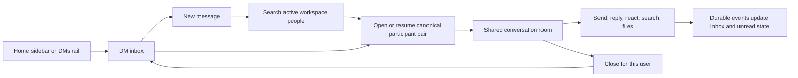

# Slack direct messages: observed flow and Space implementation

The initial November 4, 2026 audit found no Direct Message implementation. The approved first increment is now implemented in the working tree: same-workspace one-to-one and self-DMs. This document separates the original audit, observed Slack flow, shipped JavaScript evidence, public contracts, and Space's adaptation.

The practical direction is to extend the existing conversation infrastructure with explicit DM identity, membership, and per-user state. A private channel alone does not provide those semantics.

## Space before this change

| Area | Evidence | Result |
| --- | --- | --- |
| Product status | `README.md:257` | Direct messages are explicitly listed as still ahead. |
| Schema | `adapters/postgres/schema.ts:23` | Channels have a name and private flag; the inspected model has no DM kind or canonical participant identity. Messages and threads reference a channel. |
| Contracts | `packages/contracts/chat.ts:68` | Channel creation accepts name and visibility. Channel summaries have no DM participant model. |
| API | `apps/server/chat.ts:16` | Channel creation, membership, messages, history, threads, and read-state routes exist. No DM open/resume operation appears in these routes. |
| Sidebar | `packages/ui/src/sidebar.tsx:18` | The reusable component accepts a `direct` section. This is presentation support, not a complete feature. |
| Application wiring | `apps/web/src/Chat.tsx:275` | Every supplied conversation is assigned to `channels`. The new-message action targets the current channel composer rather than selecting recipients. |

This is a source inspection of the working tree, which already contained substantial unrelated changes. It is not a production deployment check. The table records the pre-implementation baseline; it no longer describes the updated source.

## Slack behavior observed in the browser

The DMs navigation item opens a dedicated inbox with a conversation list, search, an unread filter, and a new-message button. A self-DM appears in the list with an empty-state description for personal notes and files.

The new-message view contains a To field and the standard rich message composer. In the inspected state, the picker offered people, apps, and channel destinations. Selecting the self-DM displayed its existing conversation context above the composer. Formatting, attachments, emoji, mentions, audio/video controls, and scheduled-send controls use the familiar messaging surface.

These observations establish the visible inbox and compose flow. Sending, multi-user delivery, group creation, history sharing, and authorization failures were not exercised. No messages or invitations were sent.

## Slack behavior established by its public contract

Slack represents channels, DMs, and group DMs through a common conversation abstraction. The API exposes type-specific fields such as `is_im`, `is_mpim`, and `is_open`. This describes the public model, not Slack's private database schema. [Conversation object](https://docs.slack.dev/reference/objects/conversation-object/)

`conversations.open` opens or resumes a conversation. It accepts one to eight other user IDs; the caller is included automatically. Calling it again with the same participant set returns the existing conversation. The API also supports checking for an existing conversation without creating one through `prevent_creation`. [Open or resume a DM](https://docs.slack.dev/reference/methods/conversations.open/)

Adding participants is a separate operation in the product: the user chooses conversation history to include, and Slack moves that selected history into a new group DM with the additional people. Members receive system notifications. This requires an explicit history-sharing boundary rather than silently adding someone to all prior messages. [Add people to a DM](https://slack.com/help/articles/1500002969782-Add-people-to-a-direct-message)

Slack provides separate close and open operations, so closing a conversation is distinct from deleting its message history. [Close a conversation](https://docs.slack.dev/reference/methods/conversations.close/), [resume a conversation](https://docs.slack.dev/reference/methods/conversations.open/)

Slack's April 2023 engineering description uses persistent WebSocket connections, regional gateway servers, and conversation-routed event distribution. Messages and other updates travel through the same delivery architecture. That published description is useful architecture evidence; it does not prove Slack's entire current backend is unchanged. [Real-time messaging](https://slack.engineering/real-time-messaging/)

## Findings from shipped JavaScript

The selected assets were discovered from script-parsed events in the open Slack tab and acquired from Slack's public CDN. Brotli response bodies were decoded before analysis. REA 6.8.0 parsed all three decoded files, finding 24 modules with no parse failures.

| Bundle | Observed code | Supported interpretation |
| --- | --- | --- |
| `dms-list-view.js` | `DmsPage`, `DmsHeaderSearchBarSearcher`, and `DmsPageBanner`; search options include MPIMs and self; internal/external filters; selected conversation and scroll key passed to the list | The DM inbox has its own composition and search logic, with conversation selection preserved in the list. |
| `composer-page.js` | Draft IDs, pending destinations, recipient state, and recent-history context | Compose state is distinct from an already-open conversation. Recipient selection and an existing-history preview are part of the composer flow. |
| `convert-mpim.js` | Private-channel name validation, conversion eligibility, an asynchronous conversion action, and handling for `conversion_already_started` | Group-DM conversion has a dedicated flow with eligibility and in-progress handling. This code does not establish the server's concurrency implementation. |

REA evidence: `ev_c1f0d0a0ecb2a70137dd085f6bfc8bdbdacfc3a64372eddb9ec7ad666512a936`.

The retained local artifact directory is `/Users/kai/.codex/visualizations/2026/11/04/01a1a4d1-2f27-73a3-9625-ad07057c7e2e/slack-dm-evidence/`. It contains the source URLs and SHA-256 digests in `manifest.json`, decoded source files, the REA summary, and complete Evidence. These artifacts are outside the repository.

Coverage is limited to the three selected frontend bundles. Shared dependencies and Slack's server implementation were not reconstructed. REA reports partial application coverage and unresolved semantic relationships; successful parsing is not full semantic recovery. Its CLI completed on Node 25.2.1, which its doctor reports outside the supported runtime range. The findings above are also directly visible in the retained source text.

## Proposed Space design

The following is a reconstruction proposal for Space, not a claim about Slack's private implementation.

1. Add an explicit conversation kind for channels, one-to-one DMs, self-DMs, and group DMs. The existing channel identifier can remain the shared message/thread transport identifier during an incremental migration.
2. Add an atomic open-or-resume operation. Derive a canonical key from the workspace, conversation kind, and sorted unique participant IDs. Enforce uniqueness in PostgreSQL and handle concurrent inserts through constraints and bounded transaction retries. Do not add explicit database locks or distributed locks.
3. Keep membership separate from each user's inbox preferences. Closing or hiding a DM must preserve history and must not remove another participant's access. Track read cursor, mute state, and visibility per user.
4. Require participant membership for message history, search, files, thread reads, realtime subscriptions, and writes. A workspace role or agent installation must not implicitly grant access to a private conversation. Revalidate access when membership or workspace status changes.
5. Reuse the composer, message timeline, threads, attachment access checks, client-message idempotency, and durable event delivery. Extend them with DM-aware permissions and presentation. Review inherited implementations against the project's architecture principles before reuse.
6. Deliver inbox changes to participants even when that conversation is not currently open. Use event-driven updates and durable reconnect recovery, with bounded subscriptions and cursor pagination. Do not introduce periodic inbox fetching or recurring database scans.
7. Build recipient search, an existing-conversation preview, a DM header, and inbox rows with participant names, avatars, latest-message previews, and unread state. Include the self-DM case explicitly.
8. Treat adding people as creating or resolving a different participant set. History sharing needs a deliberate policy covering messages, threads, and files before implementing Slack-style history transfer.

The first useful increment is same-workspace one-to-one and self-DMs, including open/resume, send/reply, attachments, unread state, hide/reopen, and reconnect behavior. Group DMs follow with explicit membership and history semantics. External Slack Connect-style invitations, huddles, and channel conversion are separate scope.

Meaningful acceptance checks include simultaneous reciprocal opens producing one conversation; retrying a send producing one message; no history or file access for nonparticipants; notifications reaching an inactive conversation; monotonic read state across tabs; reconnect recovery; closing without history loss; workspace deactivation revoking access; and recipient changes never exposing history without an authorized sharing action.

## Flow traced in Slack on November 4

| Starting state | Action | Observed result |
| --- | --- | --- |
| Workspace Home | Choose DMs in the rail | Dedicated inbox, Find a DM, Unreads, New message, and conversation list |
| DM inbox | New message | To recipient field with the shared rich composer |
| Recipient field | Search for the signed-in user | A self recipient can be selected; selected recipient and existing context appear above the composer |
| New-message view | Close composer, select the self-DM row | Full conversation with participant heading, Messages tab, note-taking empty state, and composer |
| Conversation | More conversation actions | Search, conversation details, profile, copy, star, summarize, and split-view actions |
| Actions | Conversation details → Open conversation details | Details dialog with About/Tabs, topic, profile, mute/star controls and conversation ID |

No Slack messages, invitations, mute/star preferences, or paid features were submitted. The original channel was restored afterward. Group history sharing and delivery remain public-contract evidence, not browser-tested behavior. No personal profile data or message bodies from Slack are retained in this report.

## Implemented Space flow

Space now uses an inline To field and the shared rich composer beside its DM inbox. Selecting a recipient opens the authorized canonical conversation and carries over unsent text. Existing destination drafts are retained above the new text. Group DMs, external invitations, mute controls, canvases, huddles, scheduling, and history transfer remain separate capabilities. Opening a DM reveals it to the initiating user; the recipient sees it when a message arrives. Closing hides only that user's inbox entry. Reopening returns the same ID and history. New incoming messages restore visibility. Self-DMs have one participant and do not create unread counts for one's own messages.

Migration `039_direct_messages.sql` adds a canonical workspace/participant pair, immutable membership constraints and per-user inbox state. `DirectMessageStore` provides bounded people search, participant-only summaries, open/resume and visibility. Inbox cursors capture timestamp plus ID at the page boundary, preserving microseconds so later activity cannot move the anchor. The API reuses existing message/thread/search/file/read endpoints after participant authorization. Workspace role and agent grants do not grant implicit DM access. Deactivation revokes workspace access while retaining canonical history for reactivation.

The UI subscribes to workspace and selected-conversation resource events, coalesces refreshes, cancels obsolete reads, and revalidates on reconnect. It adds no periodic inbox polling. Message idempotency and existing per-user root-message read semantics remain shared with channels. New DM mutation paths use constraints and bounded serializable transaction retries, without explicit database or distributed locks.

Known inherited gap: shared attachment finalization/preview still uses its existing processing lease and retry loop. This change preserves its recovery behavior; migrating that processor is separate architecture work. Attachment binding and download authorization are covered by integration tests, while actual object-storage uploads were unavailable in the isolated browser fixture.

The migration was exercised in disposable schemas. It has not been applied to the user's existing development or production database. No commit, push, or deployment is included.

## Verification

- Production build: 13 tasks passed; repository typecheck: 23 tasks passed. Existing bundler dependency directive warnings remain.
- Focused web suite: 62 tests passed, covering DM picker/inbox/hide, full chat regressions, and opening a mention in a different DM.
- Serialized PostgreSQL/API regression suite: 52 tests passed across direct messages, assets, mentions, unread state, partitions, and channel management. An expired-upload test was corrected to allow the already-cleaned 404 state only when the asset row is confirmed absent; attachment rejection remains strict.
- Browser: isolated authenticated workspace, recipient search, send, Home sidebar entry, close/reopen with retained history, and desktop/390px mobile navigation. The fixture used a disposable database schema and was cleaned up.
- Focused independent review found two issues—mention routing and moving pagination anchors—both fixed and covered by regressions.

These are local source and synthetic-environment checks, not a production deployment or full-repository test-suite result.

## DM layout refinement, 2026-11-04

The inbox uses Space's plum sidebar tokens, a compact title/Unreads switch/new-message row, participant avatars with image fallback and presence, and selected-row contrast. New message keeps the inbox available on desktop and uses the existing list/conversation back navigation on narrow screens. The To field receives initial focus; cancelling restores focus to the inbox New message control and retains the draft. Text edited while open/resume is pending is included in the handoff.

Empty DMs show the participant introduction near the composer. Conversation search, details, files and close use existing capabilities, with details/files/close also available from the conversation menu. Unsupported recording and shortcut controls are hidden in DM composers and their threads. No new DM transport, polling, permissions or database migration is introduced by this UI refinement.
