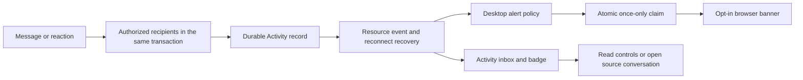

# Slack notifications: flow research and Space implementation

Observed on November 4, 2026. The user requested the same reverse-engineer-and-build workflow used for Direct Messages. The original Space source provided a mentions inbox, mention pause preferences, per-channel unread cursors and durable resource updates. It did not provide a general Activity inbox or browser notification delivery.

## Evidence and observed flow

| Surface | Action | Observed result |
| --- | --- | --- |
| Main navigation | Activity | Dedicated Activity surface with All, DMs, Mentions, Threads, unread filtering, detailed/dense layout, search and settings |
| Activity | Settings | Options for whether DMs, channel posts and reminders appear in Activity; link to all notification settings |
| Preferences | Notifications | Separate delivery controls for desktop/mobile and message categories; thread replies; Activity inclusion; keywords; mobile timing; message-preview privacy; sounds |
| Preferences | What to notify you about | Everything or Mentions and direct messages |
| Profile | Notifications | Pause menu with 30 minutes, 1 hour, 2 hours, tomorrow, next week and custom; working-hours entry |
| Channel header | Edit notifications | All new posts, Just mentions, Mute and hide, and More options |

No Slack items were opened or marked read for this investigation. No messages were sent and no preferences, permissions or pause choices were changed. The original channel was restored and the debugger listener disabled. The existing workspace had little Activity, so populated multi-user delivery, bulk read and OS-banner behavior were not exercised in Slack.

Slack's public Activity guide describes a durable feed with unread counts, type filters and read/clear controls, including DMs, mentions, followed threads and reactions. The UI observations above corroborate navigation, not Slack's private storage or concurrency implementation. [Activity guide](https://slack.com/help/articles/19693583638803-Get-your-work-done-from-the-Activity-view)

Slack separates alert delivery preferences from the feed. Its documented pause behavior stops interruptions while preserving messages for catch-up; schedules and urgent/VIP bypass are additional policies. [Pause notifications](https://slack.com/help/articles/214908388-Pause-your-Slack-notifications). Desktop/mobile delivery and message previews are configurable. [Configure notifications](https://slack.com/help/articles/201355156-Configure-your-Slack-notifications)

## Shipped JavaScript analysis

Two public CDN bundles were identified from `Debugger.scriptParsed` events in the real Slack tab, downloaded and Brotli-decoded when necessary, then analyzed as inert source using REA 6.8.0. The retained manifest includes original URLs, byte lengths and SHA-256 digests. REA parsed both files: 321,751 bytes, 22 modules, zero parse failures.

- `activity-inbox.js` contains `ActivityInboxView`, `useStripSidebarEffect` and `useFallbackToActivityListEffect`. These switch the Activity surface between primary/sidebar layouts based on state and flags. Most actual feed behavior is imported from unavailable shared modules.
- `preferences.js` renders Messaging defaults, Activity inclusion controls and per-conversation settings. Separate preference identifiers include `desktop_push_notifications`, `mobile_push_notifications`, `no_text_in_notifications`, `notification_keywords`, and day-specific `dnd_*` keys. Handlers dispatch preference updates; these are evidence of distinct policy controls, not proof of backend delivery guarantees.

Evidence ID: `ev_a179d31810c117478bb99644439ebbc4f96dedb5ebfa558613f2a5f2781842ad`.

Artifacts: `/Users/kai/.codex/visualizations/2026/11/04/01a1a4d1-2f27-73a3-9625-ad07057c7e2e/slack-notification-evidence/` (`manifest.json`, `sources/`, `evidence.json`). No session cookies or private Slack message content are included. Coverage is partial: imported shared modules, server internals and OS delivery are unknown. Syntax recovery does not establish runtime reachability. REA completed using the existing Node runtime, previously reported outside its supported range.

## Space adaptation

Activity records are distinct from channel unread cursors. A single message can be a mention, DM, followed reply, or opted-in channel message, with mention priority avoiding duplicate rows for the same recipient. Reactions notify the original human author once for each reactor/emoji identity. Self activity does not notify the sender. Explicit thread unsubscriptions survive later participation.

Activity offers All, DMs, Mentions, Threads, Reactions, Unreads, read/unread controls and bounded pagination. Opening an item routes to the correct channel or DM and its source message. The original mentions surface remains available for its existing workspace broadcast settings. Notification preferences apply per user across workspaces; channel-specific overrides are separate future scope.

Mark-all uses a consistent inbox snapshot and its latest ID. An atomic recipient/workspace head update occurs before allocating each new notification ID, so a lower ID cannot commit after a higher watermark has been observed. Recipient writes are ordered and deadlock/serialization retries are bounded. These are normal PostgreSQL writes, not physically lock-free operations. Legacy mention read state and Activity mention read state synchronize in both directions with distinct-value guards.

Desktop alerts require an explicit permission action and an open Space browser session. Initial load and reconnect do not replay a backlog of banners. At most three fresh items per refresh are considered; the current visible conversation and a visible Activity view suppress interruptions. A server-side atomic claim prevents duplicate delivery across tabs and returns currently authorized content; preview text is off by default. A tab crash between claim and display may lose the transient banner, but the unread Activity record remains available. There is no push delivery while the browser is closed.

Pausing or disabling alerts preserves Activity and its unread count. Thread-reply alert preferences are separate from thread following. Claiming rechecks current preferences and access, so a stale client does not grant permission to show cached private text.

## Scope and inherited gaps

This increment covers human messages and reactions. Agent task/session outputs, external app integrations, email/mobile push, keywords, recurring notification schedules, VIP bypass, sounds, custom saved views, clearing/archiving Activity, and per-conversation notification overrides remain separate work. Space's Activity navigation opens the existing conversation and source-message view; it does not reconstruct Slack's inline reply surface.

New notification paths use event-driven updates, atomic writes, uniqueness constraints and bounded retries. Existing regular-channel message transactions and migration infrastructure still contain explicit locks; they are inherited architecture migration work, not new notification mechanisms. No throughput or production reliability claim is made.

## Verification and rollout

- Frontend: 70 tests passed across Chat, Activity/preferences/thread following, and browser delivery. Coverage includes stale GET/PATCH responses, revocation, initial/reconnect backlog suppression and closing private banners when channel access disappears.
- Backend: 36 notification, legacy-mention, DM and agent-memory integration tests passed in fresh isolated schemas, including concurrent sends, delayed commit watermark safety, duplicate claims, authorization, read synchronization and realtime recovery. The source-message endpoint now uses ordinary chat authorization; participant access, outsider/revoked denial, channel/message mismatch and unchanged DM memory restrictions are covered.
- Browser: isolated synthetic users on ports 3194/5194 exercised Activity filters, read/unread, mark-all, pause/resume and a new DM appearing without page reload. The refreshed API also verified DM source-message opening and bidirectional legacy mention read synchronization. Desktop and 390px mobile layouts were inspected. Browser permission was not granted and actual operating-system banners were not tested; delivery policy uses mocked browser API tests.
- The production build passed. The initial repository-wide typecheck exposed an optional-response access in the agent activity test; it was corrected before integration. Final pre-push verification passed all 27 build/typecheck tasks and all 835 tests, including the notification integration and UI cases.

Apply migration 040 through the normal migration workflow before running the new API, then rebuild/restart the API and frontend. The migration backfills eligible existing mentions and human thread participation; old DMs/reactions are not turned into a backlog. Verification used disposable schemas only; it did not apply the migration to the shared database or deploy the feature.
